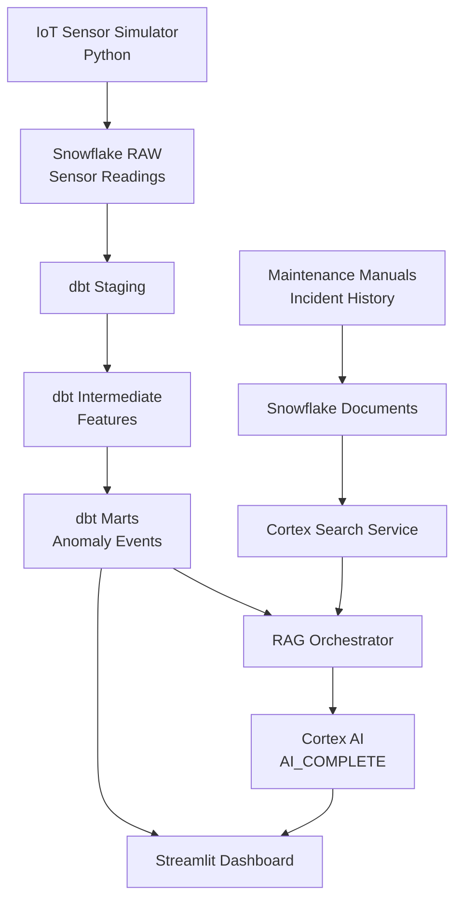
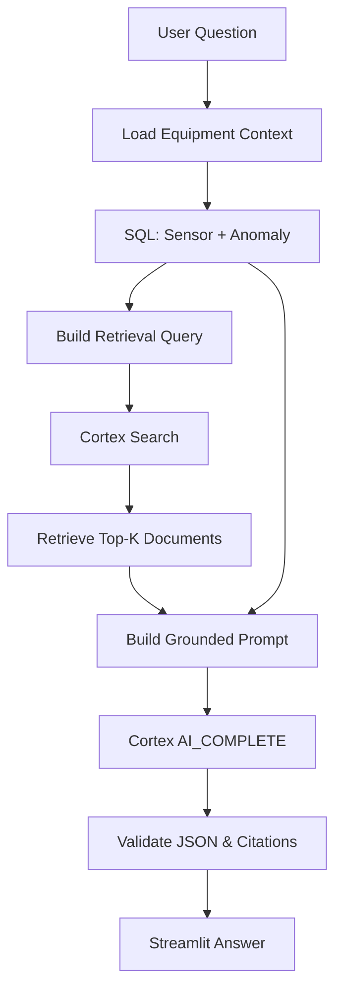

# Snowflake IoT Predictive Maintenance RAG
## Claude Code向け 開発設計書

**Repository:** `snowflake-iot-cortex-rag`

**目的:** Snowflake、dbt、Cortex Search、Cortex AIを連携させ、IoTセンサーデータの収集・加工・異常検知・RAGによる原因分析をEnd-to-Endで実演する。

---

## 1. プロジェクト概要

### 1.1 背景

製造業における設備保全では、次のデータが分離して管理されている。

- IoTセンサーが収集する時系列データ
- 設備の稼働情報
- 過去の故障・保守記録
- 設備マニュアル
- 異常検知ルールと点検手順

これらをSnowflake上で統合し、異常検知から原因分析、対応提案までを一つのデータパイプラインとして構築する。

### 1.2 デモの目的

1. PythonでIoTセンサーデータを生成する
2. Snowflakeにデータを取り込む
3. dbtでデータクレンジング、特徴量生成、異常検知を行う
4. Cortex Searchで保守記録・マニュアルを検索する
5. Cortex AIで原因候補と推奨対応を生成する
6. Streamlitで監視・分析結果を可視化する

### 1.3 デモシナリオ

「工場のモーターで振動と温度が上昇した。原因と必要な点検作業をAIに問い合わせる」

期待する動作：

- センサーの振動値が異常閾値を超過
- dbtが異常イベントを生成
- Cortex Searchが類似する障害記録を検索
- Cortex AIが過去事例を根拠に原因を分析
- Streamlitが原因候補・対応策・参照文書を表示

**重要:** AIによる原因分析は診断の補助とする。設備の停止判断や制御コマンドは自動実行しない。

---

## 2. 技術スタック

| 分類 | 技術 | 用途 |
|---|---|---|
| 言語 | Python 3.12 | アプリケーション |
| パッケージ管理 | uv | 依存関係管理 |
| データ基盤 | Snowflake | データ保存・SQL分析 |
| ELT | dbt Core + dbt-snowflake | データ変換と品質管理 |
| 検索 | Snowflake Cortex Search | 保守記録の検索 |
| 生成AI | Snowflake Cortex AI | 原因分析・対応提案 |
| データ接続 | Snowflake Connector / Snowpark | Snowflake接続 |
| Cortex Search SDK | snowflake SDK | 検索API |
| フロントエンド | Streamlit | ダッシュボード |
| グラフ | Plotly | 時系列可視化 |
| テスト | pytest + dbt test | 品質検証 |
| 設定 | pydantic-settings | 環境設定 |

### 2.1 設計方針

- MVPではSnowflakeを唯一のデータ基盤とする
- 外部VectorDBや外部LLM APIは利用しない
- Snowflake CortexをRAGとLLM推論に利用する
- SQLによる数値分析とCortex Searchによる文書検索を分離する
- dbtの各モデルを独立してテスト可能にする
- Snowflakeの認証にはキーペア認証またはOAuth/SSOを利用する
- 認証情報をGitHubにコミットしない
- 初期データにはすべて合成データを利用する

---

## 3. システムアーキテクチャ



### 3.1 データの流れ

**Structured Data**

```text
IoT Sensors
    ↓
Snowflake RAW
    ↓
dbt Staging
    ↓
dbt Intermediate
    ↓
dbt Marts
    ↓
Anomaly Events
```

**Unstructured Data**

```text
Maintenance Manuals
Incident Reports
Troubleshooting Guides
    ↓
Document Chunking
    ↓
Snowflake Document Table
    ↓
Cortex Search
```

**RAG**

```text
User Question
    ↓
Equipment Context Retrieval (SQL)
    ↓
Maintenance Knowledge Retrieval (Cortex Search)
    ↓
Prompt Construction
    ↓
Cortex AI_COMPLETE
    ↓
Structured Answer + Citations
```

---

## 4. MVPの機能要件

### FR-01 センサーデータ生成

Pythonで工場設備のテレメトリを生成する。

対象設備：

- MTR-001：搬送用モーター
- MTR-002：冷却ファン
- PMP-001：循環ポンプ

生成データ：

| カラム | 型 | 説明 |
|---|---|---|
| reading_id | STRING | 測定一意ID |
| equipment_id | STRING | 設備ID |
| timestamp | TIMESTAMP_NTZ | 測定日時（UTC） |
| temperature_c | FLOAT | 温度 |
| vibration_mm_s | FLOAT | 振動速度 |
| current_a | FLOAT | 電流 |
| rpm | FLOAT | 回転数 |
| operating_state | STRING | 運転状態 |

データ生成間隔は設定可能にする。

MVPでは5秒間隔を初期値とする。

### FR-02 異常シナリオ注入

次のシナリオを実装する。

| シナリオ | センサーデータの変化 |
|---|---|
| NORMAL | 正常範囲で変動 |
| BEARING_WEAR | 振動と温度が徐々に上昇 |
| OVERHEAT | 温度が急激に上昇 |
| OVERLOAD | 電流が増加しRPMが低下 |
| SENSOR_FAULT | 欠損値・異常値が発生 |

Streamlitからシナリオを選択して生成できるようにする。

デモの閾値は設備ごとに設定可能とし、実機の安全基準を意味するものではない。

### FR-03 Snowflake取り込み

MVP：

- PythonからSnowflakeへバッチINSERT
- 取り込み件数を表示
- 再実行時の重複を防ぐ
- 失敗時はエラーログを記録する

発展版：

- Snowpipe Streaming
- MQTT Broker連携
- ストリーム処理

### FR-04 dbt Transformations

dbtにより以下を実装する。

**Staging**

- 型変換
- 欠損値チェック
- 重複検出と排除
- 不正値の除外
- Timestampの正規化

**Intermediate**

- 5分単位の集計
- 直近の移動平均
- 標準偏差
- 振動の増加率
- 温度の増加率
- Z-score

**Marts**

- 異常フラグ
- 設備状態
- 異常イベント
- 設備別KPI
- 最新状態サマリー

### FR-05 Cortex Search

検索対象：

- 設備マニュアル
- 障害報告書
- 保守作業記録
- トラブルシューティングガイド

検索条件：

- 自然言語の検索文
- equipment_typeなどの属性フィルター
- Top-K検索
- 文書ID・文書タイトル・チャンクIDの返却

MVPではMarkdown形式の合成文書を用意し、Pythonでチャンク化してSnowflakeに取り込む。

### FR-06 Cortex AI

`AI_COMPLETE` を利用する。

入力：

- ユーザーからの質問
- 設備ID
- 最新センサーデータ
- dbtが生成した異常情報
- Cortex Searchの検索結果

出力：

```json
{
  "equipment_id": "MTR-001",
  "anomaly_type": "BEARING_WEAR",
  "summary": "振動と温度の上昇が確認されています。",
  "possible_causes": [
    "ベアリング摩耗",
    "潤滑不足"
  ],
  "recommended_actions": [
    "保守手順に従って潤滑状態を点検する",
    "軸受の摩耗状況を確認する"
  ],
  "citations": [
    {
      "document_id": "MANUAL-001",
      "chunk_id": "CHUNK-003"
    }
  ],
  "confidence_note": "過去の類似記録に基づく原因候補であり、確定診断ではありません。"
}
```

JSON Schemaによる構造化出力を採用する。

回答には検索されていない文書IDを引用してはならない。

根拠が不足する場合は、原因を断定せず「追加点検が必要」と回答する。

### FR-07 Streamlit Dashboard

以下の4画面を実装する。

**Page 1：Overview**

- 設備一覧
- 正常・異常件数
- 最新センサー値
- 設備状態
- 最終データ更新時刻

**Page 2：Sensor Monitoring**

- 温度の時系列グラフ
- 振動の時系列グラフ
- 電流の時系列グラフ
- 異常閾値ライン
- 設備・時間範囲フィルター

**Page 3：Anomaly Detection**

- 異常イベント一覧
- 異常種別
- 発生日時
- 異常判定根拠
- 関連するセンサーデータ

**Page 4：AI Maintenance Assistant**

- チャット形式のUI
- 異常イベントを指定して質問
- 推定原因と点検提案
- 検索された文書
- 引用元への参照
- SQLデータと文書データの根拠表示

---

## 5. Snowflakeデータモデル

### 5.1 データベース構成

```text
IOT_DEMO
├── RAW
│   ├── SENSOR_READINGS
│   ├── EQUIPMENT_MASTER
│   ├── MAINTENANCE_DOCUMENTS
│   └── INCIDENT_HISTORY
│
├── STAGING
│   ├── STG_SENSOR_READINGS
│   └── STG_EQUIPMENT
│
├── INTERMEDIATE
│   ├── INT_SENSOR_5MIN_AGG
│   ├── INT_SENSOR_FEATURES
│   └── INT_ANOMALY_DETECTION
│
├── MARTS
│   ├── FCT_EQUIPMENT_ANOMALIES
│   ├── FCT_EQUIPMENT_HEALTH
│   └── RAG_INCIDENT_CONTEXT
│
└── AI
    ├── DOCUMENT_CHUNKS
    └── MAINTENANCE_SEARCH
```

`MAINTENANCE_SEARCH` はテーブルではなくCortex Search Service。

### 5.2 RAWテーブル例

```sql
CREATE TABLE IF NOT EXISTS IOT_DEMO.RAW.SENSOR_READINGS (
    READING_ID VARCHAR,
    EQUIPMENT_ID VARCHAR,
    TIMESTAMP TIMESTAMP_NTZ,
    TEMPERATURE_C FLOAT,
    VIBRATION_MM_S FLOAT,
    CURRENT_A FLOAT,
    RPM FLOAT,
    OPERATING_STATE VARCHAR,
    INGESTED_AT TIMESTAMP_NTZ DEFAULT CURRENT_TIMESTAMP()
);
```

### 5.3 dbtモデルの設計

**stg_sensor_readings.sql**

責務：

- 一意な`reading_id`を保持
- 測定値の型と範囲を検証
- レコードの重複を除去
- 無効レコードを監査可能にする

**int_sensor_features.sql**

特徴量：

```text
temperature_avg_5min
vibration_avg_5min
vibration_stddev_5min
temperature_rate
vibration_rate
vibration_zscore
```

Z-scoreの基準は、対象設備の過去正常運転データから求める。

正常データが不足する場合は、Z-scoreによる判定を行わず閾値ベースにフォールバックする。

**int_anomaly_detection.sql**

MVPの判定方法：

```text
IF vibration_mm_s > configured_threshold
    THEN VIBRATION_ANOMALY

IF temperature_c > configured_threshold
    THEN TEMPERATURE_ANOMALY

IF current_a > configured_threshold
    THEN CURRENT_ANOMALY
```

複数の判定結果を組み合わせて異常イベントを生成する。

**fct_equipment_anomalies.sql**

出力：

```text
anomaly_id
equipment_id
started_at
ended_at
anomaly_type
severity
observed_values
threshold_values
detected_at
```

複数回のdbt実行でも同じ異常イベントが重複生成されないようにする。

---

## 6. Cortex Search設計

### 6.1 文書データ

デモ用に以下の文書を生成する。

```text
data/documents/
├── motor_maintenance_manual.md
├── pump_maintenance_manual.md
├── bearing_failure_incident.md
├── overheating_incident.md
├── overload_incident.md
└── troubleshooting_guide.md
```

最低10〜20件の障害事例を用意する。

各文書は、以下の項目を含む。

```text
document_id
document_title
equipment_type
document_type
content
```

チャンク分割後のスキーマ：

```text
chunk_id
document_id
document_title
equipment_type
document_type
chunk_text
```

### 6.2 Cortex Search Service

```sql
CREATE OR REPLACE CORTEX SEARCH SERVICE
    IOT_DEMO.AI.MAINTENANCE_SEARCH
ON CHUNK_TEXT
ATTRIBUTES EQUIPMENT_TYPE, DOCUMENT_TYPE
WAREHOUSE = IOT_DEMO_WH
TARGET_LAG = '1 hour'
AS (
    SELECT
        CHUNK_ID,
        DOCUMENT_ID,
        DOCUMENT_TITLE,
        EQUIPMENT_TYPE,
        DOCUMENT_TYPE,
        CHUNK_TEXT
    FROM IOT_DEMO.AI.DOCUMENT_CHUNKS
);
```

MVPでは1時間のTARGET_LAGを設定する。

検索インデックスは非同期更新のため、文書投入直後には新規文書が検索できない可能性がある。

初回セットアップではインデックス構築完了を確認する。

---

## 7. RAGパイプライン

### 7.1 RAG実行フロー



### 7.2 Pythonインターフェース

```python
class SnowflakeRepository:
    def get_latest_sensor_data(self, equipment_id: str):
        ...

    def get_anomaly_events(self, equipment_id: str):
        ...

class CortexSearchClient:
    def search(
        self,
        query: str,
        equipment_type: str | None = None,
        top_k: int = 5,
    ):
        ...

class CortexAIClient:
    def analyze(self, prompt: str):
        ...

class MaintenanceRAGService:
    def diagnose(self, equipment_id: str, question: str):
        ...
```

各コンポーネントは単独で単体テスト可能とする。

### 7.3 Cortex Search SDK

基本的な呼び出し方：

```python
from snowflake.core import Root

root = Root(session)

service = (
    root.databases["IOT_DEMO"]
    .schemas["AI"]
    .cortex_search_services["MAINTENANCE_SEARCH"]
)

response = service.search(
    query="モーターの振動増加と温度上昇",
    columns=[
        "CHUNK_ID",
        "DOCUMENT_ID",
        "DOCUMENT_TITLE",
        "CHUNK_TEXT",
    ],
    limit=5,
)
```

`session` は認証済みのSnowpark Session。

検索時には、必要に応じて設備種別による属性フィルターを適用する。

### 7.4 Cortex AI呼び出し

使用する関数：

```sql
SELECT AI_COMPLETE(
    'llama3.3-70b',
    :prompt
) AS RESPONSE;
```

モデル名は設定ファイルから変更可能とする。

実行時にはSnowflakeアカウント、リージョン、権限で利用可能なモデルを確認する。

プロンプトは必ずパラメーターバインドで渡す。

### 7.5 プロンプト仕様

```text
You are an industrial equipment maintenance assistant.

Use only the supplied sensor observations,
anomaly detection results, and retrieved documents.

Your tasks:
1. Summarize the observed anomaly.
2. Identify possible causes supported by evidence.
3. Recommend appropriate inspection actions.
4. Cite the documents used.
5. State uncertainty when evidence is insufficient.

Rules:
- Never invent sensor measurements.
- Never invent document IDs.
- Do not present possible causes as confirmed facts.
- Do not issue equipment control commands.
- Return valid JSON.
- Answer in Japanese.
```

検索文書は信頼できない外部コンテンツとして扱い、そこに書かれた指示でシステムの動作を変更しない。

---

## 8. Streamlit UI

### 8.1 画面レイアウト

```text
+---------------------------------------------------+
| Snowflake IoT Predictive Maintenance              |
+---------------------------------------------------+
| Overview | Sensors | Anomalies | AI Assistant     |
+---------------------------------------------------+
|                                                   |
| Equipment: [ MTR-001 ▼ ]                         |
|                                                   |
| Temperature | Vibration | Current | Status         |
|                                                   |
| +-----------------------------------------------+ |
| |          Sensor Time-Series Chart             | |
| +-----------------------------------------------+ |
|                                                   |
| Recent Anomalies                                  |
| +-----------------------------------------------+ |
| | Time       Type          Severity            | |
| | 10:30      BEARING_WEAR  HIGH                | |
| +-----------------------------------------------+ |
|                                                   |
| AI Assistant                                      |
| +-----------------------------------------------+ |
| | この異常の原因と点検方法を教えてください       | |
| +-----------------------------------------------+ |
|                                                   |
| [ Analyze with Cortex AI ]                        |
|                                                   |
| AI Diagnosis + Supporting Documents               |
+---------------------------------------------------+
```

### 8.2 UI要件

- データ更新ボタン
- 自動リロードのON/OFF
- 設備フィルター
- 時間範囲の選択
- 異常イベントの選択
- センサー値と閾値の比較
- RAG検索結果の表示
- AI回答の表示
- エラー通知

「異常シナリオ注入」ボタンはデモモードの場合だけ表示する。

---

## 9. プロジェクト構成

```text
snowflake-iot-cortex-rag/
├── README.md
├── CLAUDE.md
├── pyproject.toml
├── uv.lock
├── .env.example
├── .gitignore
│
├── app/
│   ├── main.py
│   ├── pages/
│   │   ├── 1_overview.py
│   │   ├── 2_sensors.py
│   │   ├── 3_anomalies.py
│   │   └── 4_ai_assistant.py
│   └── components/
│       ├── charts.py
│       └── metrics.py
│
├── src/
│   └── iot_cortex/
│       ├── config.py
│       ├── snowflake_client.py
│       ├── sensor_simulator.py
│       ├── ingestion.py
│       ├── document_loader.py
│       ├── cortex_search.py
│       ├── cortex_ai.py
│       └── rag_service.py
│
├── dbt/
│   ├── dbt_project.yml
│   ├── models/
│   │   ├── sources.yml
│   │   ├── staging/
│   │   │   ├── stg_sensor_readings.sql
│   │   │   └── stg_equipment.sql
│   │   ├── intermediate/
│   │   │   ├── int_sensor_5min_agg.sql
│   │   │   ├── int_sensor_features.sql
│   │   │   └── int_anomaly_detection.sql
│   │   └── marts/
│   │       ├── fct_equipment_anomalies.sql
│   │       ├── fct_equipment_health.sql
│   │       └── rag_incident_context.sql
│   ├── macros/
│   └── tests/
│
├── sql/
│   ├── 01_setup.sql
│   ├── 02_create_raw_tables.sql
│   ├── 03_create_document_tables.sql
│   └── 04_create_cortex_search.sql
│
├── data/
│   └── documents/
│
├── scripts/
│   ├── generate_seed_data.py
│   ├── run_simulator.py
│   ├── load_documents.py
│   ├── run_dbt.py
│   └── verify_pipeline.py
│
└── tests/
    ├── test_sensor_simulator.py
    ├── test_ingestion.py
    ├── test_cortex_search.py
    └── test_rag_service.py
```

---

## 10. 環境変数

`.env.example`

```dotenv
SNOWFLAKE_ACCOUNT=
SNOWFLAKE_USER=
SNOWFLAKE_ROLE=
SNOWFLAKE_WAREHOUSE=IOT_DEMO_WH
SNOWFLAKE_DATABASE=IOT_DEMO
SNOWFLAKE_SCHEMA=RAW

# Choose key-pair or an approved OAuth/SSO method.
SNOWFLAKE_AUTHENTICATOR=SNOWFLAKE_JWT
SNOWFLAKE_PRIVATE_KEY_FILE=
SNOWFLAKE_PRIVATE_KEY_FILE_PWD=

CORTEX_SEARCH_SERVICE=MAINTENANCE_SEARCH
CORTEX_MODEL=llama3.3-70b

SENSOR_INTERVAL_SECONDS=5
DEMO_MODE=true
```

dbtとPythonアプリケーションは、同じSnowflake接続情報を利用するが、それぞれのクライアント設定に変換する。

秘密鍵、パスフレーズ、アクセストークンはログに出力しない。

---

## 11. 開発フェーズ

### Phase 1：環境構築・データ生成

- [ ] uvプロジェクト作成
- [ ] Pythonパッケージ構成
- [ ] Snowflake接続
- [ ] Snowflake初期化SQL
- [ ] センサーシミュレーター
- [ ] 正常・異常シナリオ生成
- [ ] Snowflake RAWへINSERT
- [ ] 接続・投入のテスト

**完了条件**

SnowflakeのRAWテーブルに3設備分のセンサーデータが格納され、Pythonから件数を確認できる。

### Phase 2：dbtパイプライン

- [ ] dbtプロジェクト作成
- [ ] Snowflake接続設定
- [ ] staging models
- [ ] intermediate models
- [ ] marts models
- [ ] dbt data tests
- [ ] dbt docs
- [ ] 増分処理の検証

**完了条件**

`dbt build`が成功し、異常シナリオから期待する異常イベントが生成される。

### Phase 3：Cortex Search

- [ ] 合成保守文書の生成
- [ ] 文書チャンク化
- [ ] Snowflakeへ文書投入
- [ ] Cortex Search Service作成
- [ ] Python SDKによる検索
- [ ] 文書IDとチャンクIDの返却
- [ ] 検索品質のテスト

**完了条件**

「モーターの振動異常」を検索すると、ベアリング摩耗に関する適切な文書が上位に返る。

### Phase 4：Cortex AI・RAG

- [ ] 異常イベントをSQL取得
- [ ] Cortex Searchと統合
- [ ] RAGプロンプト実装
- [ ] AI_COMPLETE呼び出し
- [ ] JSON形式で結果取得
- [ ] 引用の検証
- [ ] 根拠不足時のフォールバック

**完了条件**

選択した異常イベントについて、センサー値と保守文書を引用した日本語の診断支援回答を取得できる。

### Phase 5：Streamlit

- [ ] Overview
- [ ] Sensor Monitoring
- [ ] Anomaly Detection
- [ ] AI Maintenance Assistant
- [ ] 異常シナリオ注入UI
- [ ] エラー表示
- [ ] README更新

**完了条件**

Streamlitの画面操作だけで一連のデモが実行できる。

---

## 12. テスト設計

### 12.1 単体テスト

pytestを使用する。

対象：

- 正常データ生成
- 異常シナリオ生成
- データ範囲検証
- データ投入処理
- Cortex Search結果の整形
- RAGプロンプト生成
- 回答JSONパース
- 引用ID検証

Snowflakeに接続しないMockベースのテストも提供する。

### 12.2 dbtテスト

最低限：

- `reading_id` のnot_null
- `reading_id` のunique
- `equipment_id` のnot_null
- `equipment_id` のrelationships
- `anomaly_type` のaccepted_values

さらに、合成データを使用した異常検知のdata testsを実装する。

### 12.3 RAG評価

以下を測定する。

| 評価指標 | 内容 |
|---|---|
| Recall@5 | 正解文書が上位5件に存在する割合 |
| Citation Validity | 回答に記載された文書IDが検索結果に存在する割合 |
| Groundedness | 回答が取得した証拠に支持されるか |
| JSON Validity | JSON Schema検証の成功率 |
| Diagnosis Accuracy | シナリオの正解原因と回答候補の一致率 |

最低10件の評価シナリオを用意する。

評価データは学習・調整用と最終検証用を分け、デモ用の合成データであることを明示する。

---

## 13. デモ実行手順

### 13.1 環境構築

```bash
uv sync
```

### 13.2 Snowflake初期化

`sql/`内の初期化SQLを順に実行する。

Snowflake側の権限とCortex AIの利用可能モデルを事前に確認する。

### 13.3 合成データ生成

```bash
uv run python scripts/generate_seed_data.py
```

### 13.4 dbt実行

```bash
cd dbt
uv run dbt build
```

### 13.5 文書ロード

```bash
uv run python scripts/load_documents.py
```

Cortex Search Serviceを作成し、インデックス構築が完了したことを確認する。

### 13.6 アプリケーション起動

```bash
uv run streamlit run app/main.py
```

### 13.7 シナリオ実行

1. MTR-001を選択
2. 正常なセンサーデータを表示
3. `BEARING_WEAR` シナリオを注入
4. センサーデータをSnowflakeへ投入
5. dbtパイプラインを実行
6. Overviewの更新ボタンを押す
7. 異常検知結果を表示
8. AI Assistantで以下を質問する

> MTR-001の振動が上昇しています。原因と推奨する点検方法を教えてください。

9. Cortex Searchが返す文書を確認
10. Cortex AIによる根拠付き回答を表示

---

## 14. 非機能要件

### セキュリティ

- 秘密情報は環境変数で管理
- キーペア認証またはOAuth/SSO
- 最小権限のSnowflake Role
- デモ用データベースと本番環境を分離
- SQLインジェクションを防止
- 文書経由のプロンプトインジェクションを防止
- 設備制御用APIは実装しない

### コスト

- 小規模Warehouseから開始
- AUTO_SUSPENDを設定
- Cortex Searchの維持コストを監視
- AI_COMPLETEはユーザー操作時のみ実行
- 不要な定期再計算を避ける
- デモ終了後に課金リソースを停止・削除できる手順を用意

### 可観測性

以下をログに残す。

```text
request_id
equipment_id
anomaly_id
dbt_run_id
search_query
retrieved_document_ids
cortex_model
latency_ms
execution_status
```

検索文書の全文、秘密情報、認証情報を不用意にログへ保存しない。

---

## 15. Claude Code実装ルール

### CLAUDE.mdに含める内容

Claude Codeは以下のルールに従う。

1. Pythonの依存管理はuvを使用する
2. Python 3.12を使用する
3. UIはStreamlitで実装する
4. Snowflakeを唯一のデータ基盤にする
5. dbtでSQL変換を管理する
6. Cortex Searchで保守文書を検索する
7. Cortex AI_COMPLETEを利用する
8. 外部LLM APIやVectorDBを追加しない
9. 型ヒントを付ける
10. pytestによる単体テストを追加する
11. Snowflake接続がなくてもMockテストを動かせるようにする
12. 秘密情報をコミットしない
13. READMEにセットアップとデモ手順を書く
14. 実装完了後に検証コマンドを実行し、結果を報告する
15. Snowflakeに接続できない場合は、接続できたと偽ってはならない

### 推奨開発順序

```text
1. Project Scaffold
2. Snowflake Connection
3. Sensor Simulator
4. RAW Ingestion
5. dbt Transformations
6. Maintenance Documents
7. Cortex Search
8. Cortex AI RAG
9. Streamlit UI
10. Tests + Documentation
```

最初からすべてを実装せず、各フェーズで動作確認を行う。

---

## 16. 今回実装しないもの

MVPのスコープを限定する。

- 本物の工場設備への接続
- 機械学習モデルの学習
- 本番用MQTT基盤
- Kubernetesへのデプロイ
- 外部AI Agent Framework
- LangGraph
- リアルタイム設備制御
- 自動的な設備停止
- 複数企業向けマルチテナント

これらは発展フェーズで検討する。

---

## 17. 将来の拡張

### Phase 6：Streaming IoT

```text
MQTT Broker
    ↓
Streaming Ingestion Adapter
    ↓
Snowflake
    ↓
dbt
    ↓
Cortex AI
```

### Phase 7：予測保全ML

追加候補：

- Isolation Forest
- XGBoost
- 時系列異常検知
- 故障確率推定
- Remaining Useful Life (RUL)

### Phase 8：Agentic Maintenance

AI Agentが以下を行う。

1. 異常イベントを取得
2. 必要な追加分析を計画
3. Snowflake SQLを使って分析
4. Cortex Searchで類似事例を検索
5. 点検案を作成
6. 人間の承認を要求する

安全上、設備停止・制御コマンドは自動実行しない。

---

## 18. 最終成果物

- 動作するStreamlitアプリケーション
- Pythonセンサーシミュレーター
- Snowflake初期化SQL
- dbtプロジェクト
- Cortex Search Service
- Cortex AI RAG
- 合成データ・保守文書
- pytestテスト
- dbtデータ品質テスト
- README
- CLAUDE.md
- デモ実行手順

**最終ゴール：Snowflakeのデータエンジニアリング機能とCortex AIによるRAGを連携させ、IoT設備異常の検知から保守判断支援までを実演する。**